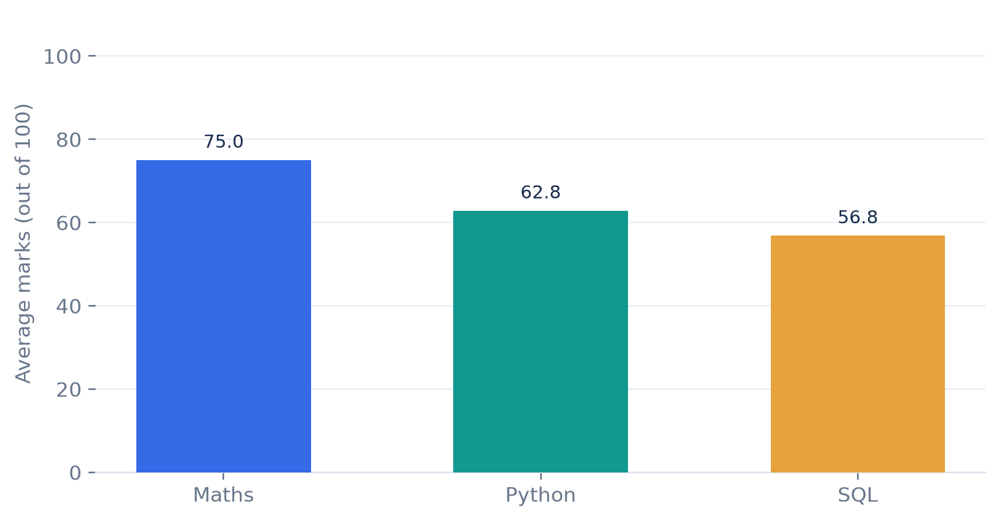
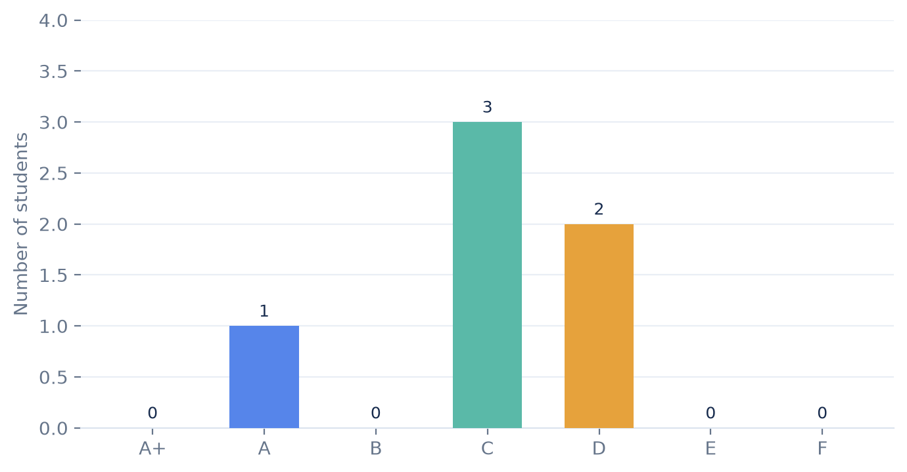

# Student Performance Analysis System

A Python-based student performance management and analysis system that stores academic records in an SQLite database and presents meaningful insights through an interactive Streamlit dashboard.

## Project Overview

This project helps manage student academic information and analyze performance across different subjects, including Mathematics, Python, and SQL.

## Key Features

- Add, view, search, update, and delete student records
- Automatic total marks and percentage calculation
- Grade and pass/fail result calculation
- Identify class toppers
- Subject-wise performance analysis
- Class performance summary
- Interactive dashboard with charts and statistics
- SQLite database integration

## Technologies Used

- Python
- SQLite
- Streamlit
- Pandas
- Matplotlib
- Git and GitHub

## Project Structure

```text
Student-Performance-Analysis/
│
├── main.py
├── dashboard.py
├── database.py
├── import_csv.py
├── test_database.py
├── students.csv
├── requirements.txt
├── README.md
└── .gitignore
```

## Installation and Setup

1. Clone the repository:

```bash
git clone https://github.com/altafkureshi34o/Student-Performance-Analysis.git
```

2. Open the project folder:

```bash
cd Student-Performance-Analysis
```

3. Install dependencies:

```bash
pip install -r requirements.txt
```

4. Run the Streamlit dashboard:

```bash
python -m streamlit run dashboard.py
```

## Database

The project uses SQLite to store student records. The database file is generated locally and is not included in the public repository.

## Developer

Altaf Kureshi

GitHub: https://github.com/altafkureshi34o

## 📸 Project Screenshots

### Subject Performance Analysis


### Grade Distribution
